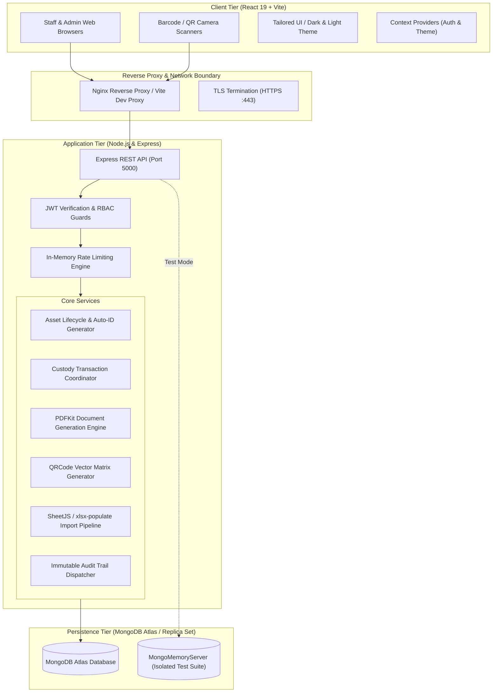

# Airports Authority of India (AAI) — Asset Management System (AMS)

[](https://nodejs.org/)
[](https://react.dev/)
[](https://expressjs.com/)
[](https://www.mongodb.com/)
[](LICENSE)

An enterprise-grade, centralized IT Asset Lifecycle and Governance Platform built for the **Airports Authority of India (AAI) Regional Offices**. The system automates end-to-end management of airport computing, communication, surveillance, and networking infrastructure — replacing error-prone manual register books with verifiable digital custody, dynamic category-driven technical specifications, automated QR-code asset tagging, official civil aviation PDF generation, physical audit campaigns, and immutable audit logging.

---

## Table of Contents

- [1. Project Overview](#1-project-overview)
- [2. Key Features](#2-key-features)
- [3. System Architecture](#3-system-architecture)
- [4. Technology Stack](#4-technology-stack)
- [5. Project Directory Structure](#5-project-directory-structure)
- [6. Prerequisites](#6-prerequisites)
- [7. Installation and Setup](#7-installation-and-setup)
- [8. Environment Variables](#8-environment-variables)
- [9. Database Setup & Seeding](#9-database-setup--seeding)
- [10. Running the Application](#10-running-the-application)
- [11. Complete API Documentation](#11-complete-api-documentation)
- [12. Application Workflows](#12-application-workflows)
- [13. Security and Access Control](#13-security-and-access-control)
- [14. Testing Suite](#14-testing-suite)
- [15. Production Deployment](#15-production-deployment)
- [16. Troubleshooting](#16-troubleshooting)
- [17. Future Roadmap](#17-future-roadmap)
- [18. Contributing](#18-contributing)
- [19. License & Acknowledgements](#19-license--acknowledgements)

---

## 1. Project Overview

Regional airports operate critical 24/7 IT, Air Traffic Management (ATM), and Communication, Navigation & Surveillance (CNS) hardware across scattered terminal buildings, radar towers, server rooms, and administrative divisions. Historically, equipment custody was tracked through physical logbooks and disjointed spreadsheets, creating compliance risks, untracked warranty expirations, custody disputes, and labor-intensive annual audit reconciliations.

The **AAI Asset Management System** solves these operational challenges by delivering:
* **Single Source of Truth**: Centralized registry for all hardware items with institutional auto-generated asset IDs (`AAI-REG-[CAT]-[YEAR]-[SEQ]`).
* **Verifiable Chain of Custody**: Formal, auditable equipment issuance, inter-departmental transfers, and returns with mandatory acknowledgment slips.
* **Proactive Maintenance & AMC Tracking**: Automatic calculation of dynamic warranty states (`ACTIVE`, `EXPIRING_SOON`, `EXPIRED`) and vendor service level agreement (SLA) contract periods.
* **Physical-to-Digital Interlock**: Instant generation of standardized 4" × 2" thermal/laser sticker labels embedded with cryptographically signed verification QR codes.
* **Official Civil Aviation Compliance**: Built-in vector PDF generation engine that automatically outputs standard AAI handover dockets, transfer slips, return certificates, and asset retirement records.

---

## 2. Key Features

### 💻 Enterprise Asset Registry & Inventory
- **Dynamic Category Schema**: Type-specific configurations for Desktop PCs, Laptops, Network Switches, Online UPS, Printers, Scanners, and CCTV systems.
- **Hardware Relationship Tree**: Parent-child topology linking auxiliary equipment (monitors, keyboards, mice, UPS units) to parent workstations.
- **Dynamic Search & Filtering**: Multi-parameter search supporting category, status, condition, department, floor, and warranty alerts.
- **Decommissioning & Retirement**: Formal retirement workflow enforcing administrator authorization and recording official disposal reasons.

### 🔄 Custody Lifecycle & Transaction Engine
- **Three-Way Custody Transitions**: Direct Assignment (Storage to Staff), Transfer (Staff-to-Staff or Department-to-Department), and Return (Staff to Godown/Storage).
- **Atomic State Updates**: Automatically synchronizes asset operational status (`AVAILABLE`, `ASSIGNED`, `GODOWN`, `RETIRED`) while updating the employee's assigned asset counter.
- **Historical Timeline**: Visual chronological ledger of every custodian who has handled a piece of equipment throughout its entire lifecycle.

### 🏷️ Physical Equipment Identification & QR Tags
- **Label Generation**: Real-time generation of 4" × 2" (288 × 144 pt) thermal/laser printable asset identification tags.
- **QR Code Interlock**: Embeds tamper-evident verification payloads containing Asset ID, Category, Make/Model, Serial Number, and Verification URLs.

### 📄 Regulatory PDF & Document Engine
- **Automated PDF Slips**: Direct streaming of vector PDFs with official AAI regional banners and signature blocks:
  - *Equipment Issue & Handover Certificate*
  - *Inter-Departmental Custody Transfer Slip*
  - *Return & Clearance Voucher*
  - *Asset Retirement & Decommissioning Docket*
  - *Annual Physical Audit Reconciliation Report*
  - *Service Desk Incident Maintenance Ticket*

### 🛠️ IT Service Desk (Complaint Desk)
- **Incident Lifecycle**: Comprehensive ticketing lifecycle (`OPEN` ➔ `IN_PROGRESS` ➔ `RESOLVED` ➔ `CLOSED`).
- **Asset Association**: Direct linking of complaints to specific hardware serials and locations for maintenance correlation.
- **Staff Self-Service**: Employees can raise tickets for their assigned assets and monitor technician resolutions.

### 📋 Physical Verification & Audit Campaigns
- **Annual Floor Audits**: Initiation of formal physical inspection campaigns across airport terminals.
- **Discrepancy Logging**: Automatic detection and tracking of missing equipment, unrecorded relocations, or physical damage.
- **Audit Reports**: Instant reconciliation summary showing total scanned assets vs. variance exceptions.

### 📊 Excel Ingestion & Bulk Export Pipeline
- **Smart Column Normalization**: Ingests messy legacy airport Excel sheets, dynamically reconciling inconsistent column headers.
- **Multi-Pass Validation**: Validates duplicates, required attributes, and format errors prior to committing records.
- **Data Export**: Complete inventory export to Microsoft Excel (`.xlsx`) with custom column inclusion.

---

## 3. System Architecture

The application adopts a decoupled Client-Server architecture designed for on-premise regional airport servers or secure government cloud infrastructure.



---

## 4. Technology Stack

### Frontend Architecture
| Layer / Tool | Technology | Version | Purpose |
|---|---|---|---|
| **Core Framework** | React | `19.2.8` | Declarative reactive UI components |
| **DOM Renderer** | React DOM | `19.2.8` | Virtual DOM rendering |
| **Build & Dev Tool** | Vite | `8.2.2` | Rapid ESM-native bundler and HMR dev server |
| **Routing** | React Router DOM | `7.1.5` | Client-side routing with role-guarded routes |
| **UI Icons** | Lucide React | `1.16.0` | Comprehensive SVG icon library |
| **Spreadsheets** | SheetJS (xlsx) | `0.18.5` | Client-side workbook parsing and export |
| **Linting & Quality** | Oxlint | `1.79.0` | High-performance Rust-based JavaScript linter |

### Backend Architecture
| Layer / Tool | Technology | Version | Purpose |
|---|---|---|---|
| **Runtime** | Node.js | `>=20.0.0` | High-throughput asynchronous JavaScript runtime |
| **Web Framework** | Express | `4.21.2` | RESTful routing and HTTP middleware pipeline |
| **Database & ODM** | Mongoose | `8.9.5` | Schema validation and MongoDB object modeling |
| **Authentication** | JSON Web Tokens (`jsonwebtoken`) | `9.0.2` | Stateless cryptographic bearer token authentication |
| **Password Security** | BcryptJS | `2.4.3` | Salted SHA-512 password hashing |
| **PDF Generation** | PDFKit | `0.20.2` | Native streaming vector PDF rendering |
| **2D Barcode Engine** | QRCode | `1.5.4` | Matrix barcode encoding for equipment tags |
| **Excel Processing** | SheetJS (`xlsx`) & `xlsx-populate` | `0.18.5` / `1.21.0` | Ingestion, validation, and encrypted spreadsheet handling |
| **Security Headers** | Helmet | `8.0.0` | HTTP response header hardening (CSP, XSS, HSTS) |
| **File Uploads** | Multer | `2.3.0` | Multipart/form-data handler for batch imports |
| **Input Validation** | Zod | `3.24.1` | Type-safe schema validation |
| **Test Database** | `mongodb-memory-server` | `11.2.0` | Zero-dependency, ephemeral in-memory database for testing |

---

## 5. Project Directory Structure

```text
aai/
├── client/                               # Frontend single-page application
│   ├── public/                           # Static assets, logos, and manifest
│   ├── src/
│   │   ├── components/                   # Reusable UI elements, modals, tables, and test fixtures
│   │   │   ├── ui/                       # Atom components (Modal, LoadMoreButton, SearchableSelect)
│   │   │   ├── CategoryAssetDetails.jsx  # Type-specific dynamic attribute visualizer
│   │   │   ├── CategoryFieldEditor.jsx   # Dynamic form fields for specific hardware types
│   │   │   ├── DynamicCreateAssetModal.jsx # Unified dynamic modal for asset onboarding
│   │   │   ├── Navbar.jsx                # Top application header with profile & notifications
│   │   │   ├── ProtectedRoute.jsx        # RBAC navigation guard (ADMIN vs EMPLOYEE)
│   │   │   └── Sidebar.jsx               # Navigation bar with collapsible state
│   │   ├── config/                       # Form definitions & dynamic category metadata
│   │   │   └── assetCategoryFormConfigs.js
│   │   ├── context/                      # React Context providers
│   │   │   ├── AuthContext.jsx           # JWT session storage, login/logout dispatch
│   │   │   └── ThemeContext.jsx          # Dark / light mode state manager
│   │   ├── pages/                        # View controllers & business pages
│   │   │   ├── AssetTransfers.jsx        # Custody transfers, returns, and assignment log
│   │   │   ├── AuditLogs.jsx             # Immutable system event viewer
│   │   │   ├── BulkImportExport.jsx      # Spreadsheet ingestion wizard and raw exporter
│   │   │   ├── ComplaintDesk.jsx         # IT service ticketing and issue management
│   │   │   ├── Dashboard.jsx             # Administrator executive analytics & KPI cards
│   │   │   ├── EmployeeDashboard.jsx     # Staff personal asset custody & ticket view
│   │   │   ├── EmployeeDirectory.jsx     # Staff directory management (CRUD)
│   │   │   ├── EnterpriseInventory.jsx   # Primary asset inventory register & drawer
│   │   │   ├── ExcelFieldManagement.jsx  # Dynamic database attribute mapping interface
│   │   │   └── Login.jsx                 # Secure login page with role switcher
│   │   ├── services/                     # Backend communication layer
│   │   │   └── api.js                    # Fetch client with global token injection
│   │   ├── utils/                        # Frontend data formatters and validation rules
│   │   ├── App.jsx                       # Route registration & layout boundaries
│   │   ├── index.css                     # Master design tokens, CSS variables, & responsive grid
│   │   └── main.jsx                      # React application bootstrapping
│   ├── package.json                      # Frontend dependencies and build scripts
│   └── vite.config.js                    # Vite bundler, proxy configuration, and ports
│
├── server/                               # Backend REST API service
│   ├── sample_data/                      # Representative AAI Excel registers for demonstration
│   ├── scripts/                          # Seeding, verification, and migration runners
│   │   ├── migrate_phase11.js            # Automated schema transformation script
│   │   ├── seed.js                       # Standalone regional database seeder
│   │   └── seed_demo.js                  # Idempotent demo credentials seeder
│   ├── src/
│   │   ├── config/                       # Infrastructure configuration (db.js, dns resolver)
│   │   ├── controllers/                  # HTTP request controllers (CRUD, PDF stream, Excel)
│   │   ├── middleware/                   # Express middleware (auth, rateLimiter, errorHandler)
│   │   ├── models/                       # Mongoose schemas (Asset, Employee, User, AuditLog, etc.)
│   │   ├── repositories/                 # Data access layer separating queries from controllers
│   │   ├── routes/                       # Express router definitions
│   │   ├── services/                     # Complex domain services (import, export, reconciliation)
│   │   ├── utils/                        # Utilities (PDF generator, QR generator, logger, tokens)
│   │   ├── app.js                        # Express application configuration and route mounts
│   │   └── server.js                     # HTTP listener, unhandled exception traps, & graceful shutdown
│   ├── test/                             # Automated test suite using Node.js native test runner
│   └── package.json                      # Backend dependencies and test scripts
│
├── package.json                          # Workspace root commands (concurrent launcher)
├── vercel.json                           # Vercel deployment rewrite rules
└── DEPLOYMENT.md                         # Production operational runbook
```

---

## 6. Prerequisites

Ensure your host environment meets the following minimum requirements:

* **Node.js**: `v20.x LTS` or higher (tested on Node v20.12+ and v22.x)
* **npm**: `v10.x` or higher
* **Database**: MongoDB instance (MongoDB 6.0+ locally, Docker container, or MongoDB Atlas cluster)
* **Operating System**: Linux (Ubuntu 22.04+), macOS, or Windows 10/11 / Windows Server 2022

---

## 7. Installation and Setup

### 1. Clone the Repository
```bash
git clone https://github.com/Roshanrameshhub/Airport-Authority-of-India.git
cd Airport-Authority-of-India
```

### 2. Install Server Dependencies
```bash
cd server
npm install
```

### 3. Install Client Dependencies
```bash
cd ../client
npm install
```

---

## 8. Environment Variables

### Backend Configuration (`server/.env`)
Create a `.env` file in the `server` directory:

```env
# Server Runtime
PORT=5000
NODE_ENV=development

# Database Connection (MongoDB Atlas or Local Instance)
MONGODB_URI=mongodb://localhost:27017/aai-asset-management

# JWT Authentication
JWT_SECRET=your_super_secret_jwt_hmac_key_2026_enterprise
JWT_EXPIRES_IN=7d

# CORS Allowed Origin
CLIENT_URL=http://localhost:5173

# Rate Limiting (Requests per 15-minute window)
RATE_LIMIT_MAX_REQUESTS=300
```

### Frontend Configuration (`client/.env`)
Create a `.env` file in the `client` directory:

```env
# In local development, leave blank so Vite's proxy automatically routes /api to http://127.0.0.1:5000
VITE_API_URL=

# For standalone production builds pointing to an external backend:
# VITE_API_URL=https://your-api-domain.com
```

---

## 9. Database Setup & Seeding

The application includes an automated seeder that initializes core AAI airport departments, standard asset categories, master hardware brands, and initial demonstration user accounts.

### Run the Regional Database Seeder
From the root directory or inside `server/`:

```bash
cd server
npm run seed
```

This populates:
1. **Departments**: Communication, Navigation & Surveillance (CNS), Airport Systems & IT, Air Traffic Management (ATM), Terminal Operations (TMO), Finance & Accounts (FIN), HR & Admin (HRA).
2. **Categories**: Desktop PC, Laptop, Printer, Scanner, Online UPS, Network Switch, Camera/CCTV.
3. **Master Catalog**: Verified makes (HP, Dell, Cisco, Lenovo, Canon) and enterprise model lines.
4. **Demo Accounts**:

| Role | Username | Password | Access Privileges |
|---|---|---|---|
| **Administrator** | `Admin` | `Admin@123` | Full access: Inventory, transfers, imports, audits, user management |
| **Employee** | `Employee01` | `Employee@123` | Staff access: Personal assigned assets, raise & view service tickets |

*(Note: Usernames are case-insensitive and stored in lowercase).*

---

## 10. Running the Application

### Option A: Running from Root (Convenience Scripts)
```bash
# Start backend in development mode (auto-reloads on file changes)
npm run server:dev

# In a separate terminal, start frontend dev server
npm run client
```

### Option B: Running Individually

**Terminal 1 — Backend API Server:**
```bash
cd server
npm run dev
# The API will start on http://localhost:5000
# Health check available at: http://localhost:5000/api/v1/health
```

**Terminal 2 — Frontend Application:**
```bash
cd client
npm run dev
# The client will start on http://localhost:5173
```

Open your browser and navigate to `http://localhost:5173`.

---

## 11. Complete API Documentation

All API endpoints are prefixed with `/api/v1` and return standardized JSON responses:

```json
{
  "success": true,
  "data": { ... },
  "message": "Operation completed successfully"
}
```

### 1. Authentication & Session (`/api/v1/auth`)
| Method | Endpoint | Access | Description |
|---|---|---|---|
| `POST` | `/login` | Public | Authenticates credentials; returns signed JWT and profile |
| `GET` | `/me` | Authenticated | Retrieves current authenticated user profile and roles |
| `POST` | `/logout` | Authenticated | Invalidates client session |

### 2. Asset Management (`/api/v1/assets`)
| Method | Endpoint | Access | Description |
|---|---|---|---|
| `GET` | `/` | Authenticated | Paginated asset query with search, category, status, and department filters |
| `GET` | `/:id` | Authenticated | Retrieves single asset details, hardware specs, and custody status |
| `POST` | `/` | Admin | Registers a new asset (auto-generates Asset ID if omitted) |
| `PUT` | `/:id` | Admin | Updates asset attributes and technical specifications |
| `PATCH` | `/:id/retire` | Admin | Decommissions and marks asset status as `RETIRED` with reason |
| `DELETE` | `/:id` | Admin | Soft-deletes or archives asset record |

### 3. Custody & Assignment Engine (`/api/v1/assignments`)
| Method | Endpoint | Access | Description |
|---|---|---|---|
| `POST` | `/assign` | Admin | Assigns asset from storage/godown to an employee |
| `POST` | `/transfer` | Admin | Transfers asset custody between employees or departments |
| `POST` | `/return` | Admin | Returns asset from employee back to storage/godown |
| `GET` | `/ledger` | Admin | Retrieves paginated custody transactions and transfer history |
| `GET` | `/asset/:assetId/history` | Authenticated | Chronological custody chain timeline for a specific device |

### 4. Regulatory PDF Generation (`/api/v1/export`)
| Method | Endpoint | Access | Description |
|---|---|---|---|
| `GET` | `/assets/excel` | Admin | Streams dynamic Excel spreadsheet of filtered inventory |
| `GET` | `/assignment/:assignmentId/pdf` | Admin, Staff | Streams official Equipment Issue & Handover Slip (PDF) |
| `GET` | `/transfer/:assignmentId/pdf` | Admin, Staff | Streams Inter-Departmental Transfer Voucher (PDF) |
| `GET` | `/return/:assignmentId/pdf` | Admin, Staff | Streams Custody Clearance & Return Slip (PDF) |
| `GET` | `/retirement/:assetId/pdf` | Admin | Streams Asset Decommissioning & Scrap Certificate (PDF) |
| `GET` | `/verification/:campaignId/pdf` | Admin | Streams Annual Physical Audit Reconciliation Report (PDF) |
| `GET` | `/complaint/:ticketId/pdf` | Admin, Staff | Streams IT Maintenance Service Request Docket (PDF) |

### 5. Physical Tags & QR Codes (`/api/v1/tags`)
| Method | Endpoint | Access | Description |
|---|---|---|---|
| `GET` | `/asset/:id/qr` | Authenticated | Generates base64 data URL and verification payload for QR code |
| `GET` | `/asset/:id/pdf` | Authenticated | Streams ready-to-print 4" × 2" physical equipment label (PDF) |

### 6. IT Service Desk (`/api/v1/complaints`)
| Method | Endpoint | Access | Description |
|---|---|---|---|
| `GET` | `/` | Authenticated | Lists service tickets (Staff views own, Admin views all) |
| `POST` | `/` | Authenticated | Raises a new IT repair / maintenance complaint |
| `PATCH` | `/:id/status` | Admin | Updates complaint status (`IN_PROGRESS`, `RESOLVED`, `CLOSED`) |

### 7. Physical Verification Audit Campaigns (`/api/v1/verification`)
| Method | Endpoint | Access | Description |
|---|---|---|---|
| `POST` | `/campaigns` | Admin | Initiates a new regional physical audit campaign |
| `GET` | `/campaigns/active` | Admin | Retrieves currently running audit campaign metrics |
| `POST` | `/record` | Admin | Submits physical inspection check for an individual asset |
| `PATCH` | `/campaigns/:id/finalize` | Admin | Concludes campaign and computes discrepancy ledger |

---

## 12. Application Workflows

### End-to-End Asset Lifecycle

```text
[ New Equipment Procured ]
            │
            ▼
[ Register Asset ] ──► System generates Asset ID (e.g. AAI-REG-PC-2026-0001)
            │
            ├─► Generate & Print 4" x 2" QR Sticker Tag (Applied to hardware)
            │
            ▼
[ Custody Allocation ] ──► Assigned to Airport Staff (e.g. Air Traffic Controller)
            │
            ├─► Generates Official PDF Handover Certificate
            │
            ├──► [ Operational Lifecycle ]
            │         │
            │         ├─► Routine Service: IT Complaint Raised ──► Resolved
            │         ├─► Custody Relocation: Staff-to-Staff Transfer Slip
            │         └─► Annual Audit: Verification Campaign Scanned
            │
            ▼
[ End-of-Life / Damaged ]
            │
            ▼
[ Decommission / Retire ] ──► Retires Asset, generates official Retirement Certificate
```

---

## 13. Security and Access Control

1. **Authentication**: Stateless HMAC-SHA256 JWT tokens transmitted via `Authorization: Bearer <TOKEN>` headers.
2. **Password Cryptography**: Passwords hashed using `bcryptjs` with salt work factor of 10.
3. **Role-Based Access Control (RBAC)**:
   - `ADMIN`: Unrestricted read/write access across all modules, configuration, and bulk data operations.
   - `EMPLOYEE`: Scoped access restricted to personal profile, assigned hardware, and personal service desk tickets.
4. **Defense in Depth**:
   - `helmet` secures HTTP headers (disables X-Powered-By, sets strict HSTS, prevents clickjacking).
   - In-memory rate limiting throttles API abuse (300 requests/15 minutes general; 30 requests/15 minutes on auth).
   - Comprehensive sanitization prevents NoSQL query injection and prototype pollution.
5. **Auditing**: Every critical transaction (transfers, status edits, user changes) generates an immutable `AuditLog` entry tracking Actor User ID, Action, Entity, Timestamp, and IP Address.

---

## 14. Testing Suite

The repository utilizes the **Node.js Native Test Runner** (`node --test`), eliminating heavy external testing framework dependencies and enabling sub-second test execution. In test mode, an isolated in-memory MongoDB server (`mongodb-memory-server`) is spun up automatically.

### Running Backend Tests
```bash
cd server
npm test
```

### Running Specific Subsystem Tests
```bash
# Category filtering normalization test
node --test test/inventory_category_filtering.test.js

# RBAC governance & authentication test
node --test test/phase13_rbac_governance.test.js

# Transaction & custody chain test
node --test test/phase7_transaction_custody_chain.test.js

# Excel v2 ingestion test
node --test test/phase12_excel_v2_ingestion.test.js
```

### Running Frontend Tests & Linting
```bash
cd client

# Run high-performance linter
npm run lint

# Validate production bundle
npm run build
```

---

## 15. Production Deployment

Refer to [`DEPLOYMENT.md`](DEPLOYMENT.md) for detailed production runbooks, PM2 clustering configurations, and SSL setup.

### Production Build Checklist
1. **Frontend**:
   ```bash
   cd client
   npm run build
   # Outputs optimized static bundle to client/dist
   ```
2. **Backend**:
   ```bash
   cd server
   export NODE_ENV=production
   # Start with PM2 Process Manager
   pm2 start src/server.js --name "aai-asset-api" -i max
   ```
3. **Reverse Proxy (Nginx)**: Configure Nginx to serve `client/dist` statically and reverse-proxy `/api` requests to `http://127.0.0.1:5000`.

---

## 16. Troubleshooting

### 1. Windows IPv6 `ECONNREFUSED` / `ECONNRESET`
* **Symptom**: Client fails to communicate with `http://localhost:5000` via Vite dev proxy.
* **Cause**: On modern Windows systems, `localhost` resolves to `::1` (IPv6), while Node.js binds to `127.0.0.1` (IPv4).
* **Fix**: The client `vite.config.js` is pre-configured to proxy directly to `http://127.0.0.1:5000`. Ensure backend listener uses IPv4 or `0.0.0.0`.

### 2. MongoDB DNS Resolution on Windows
* **Symptom**: `querySrv ENOTFOUND` when connecting to MongoDB Atlas.
* **Cause**: Windows local network adapter DNS fails to resolve SRV records.
* **Fix**: `server/src/config/db.js` explicitly configures reliable public DNS resolvers (`8.8.8.8`, `1.1.1.1`). Ensure outbound port 27017 is permitted through corporate firewalls.

### 3. Missing `JWT_SECRET` on Boot
* **Symptom**: Server startup halts with `CRITICAL SECURITY ERROR: JWT_SECRET environment variable is missing!`.
* **Fix**: Ensure `server/.env` exists and contains a non-empty `JWT_SECRET` string.

---

## 17. Future Roadmap

- [ ] **RFID Integration**: Passive RFID antenna tag reading for automated hangar and warehouse gate asset checkouts.
- [ ] **Mobile Progressive Web App (PWA)**: Offline-first audit scanning for field engineers in low-connectivity aerodrome zones.
- [ ] **Automated Preventive Maintenance Schedules**: Cron-based recurring service tickets based on equipment operating hours.
- [ ] **Central HQ Sync Protocol**: Regional-to-Central synchronization pipeline aggregating assets across all AAI regional airports.

---

## 18. Contributing

Contributions to modernize and enhance the AAI Asset Management platform are welcome:

1. Fork the Project repository.
2. Create your Feature Branch (`git checkout -b feature/OperationalImprovement`).
3. Commit your Changes with descriptive messages (`git commit -m 'Add biometric custody verification'`).
4. Push to the Branch (`git push origin feature/OperationalImprovement`).
5. Open a Pull Request for architectural review.

---

## 19. License & Acknowledgements

### License
This project is licensed under the **ISC License**. See the repository details for terms.

### Acknowledgements
* Developed for **Airports Authority of India (AAI)** Regional Office IT & Communications divisions.
* Designed in alignment with standard civil aviation hardware custody, electrical safety inspection protocols, and institutional auditing practices.
